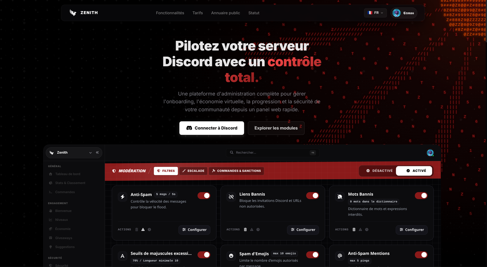
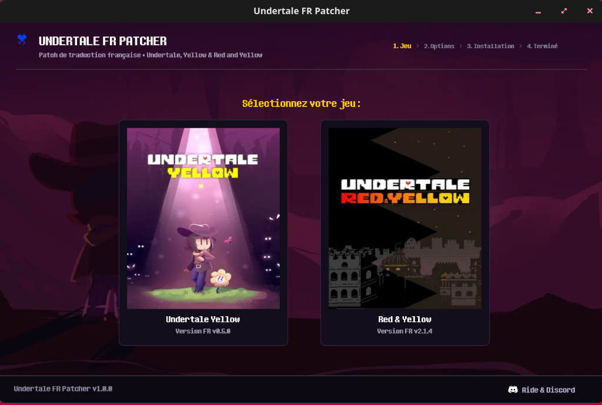
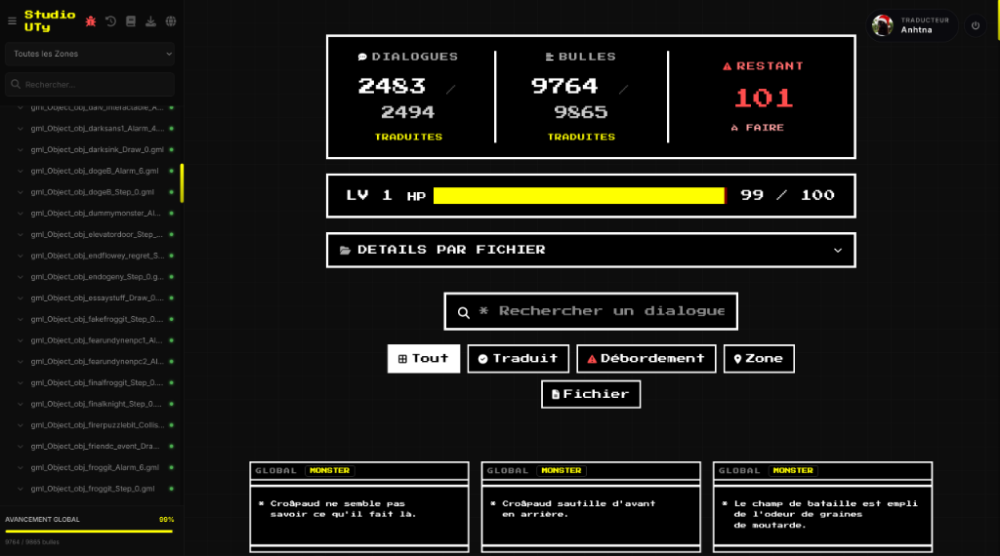

# Cronos

<strong>Développeur Full-Stack & Systèmes</strong> · Paris, France

<em>Solutions web, architectures Rust et outillage système.</em>

  
  
  
  

---

### Projet Principal — [Zenith](https://zenithbot.app)

Solution d'administration, de sécurité et d'automatisation pour les communautés Discord.

  

- **Core** : Moteur événementiel en Rust (`tokio`, `axum`, `twilight`).
- **Dashboard** : Interface temps réel sous SvelteKit et TypeScript.
- **Données** : PostgreSQL, Redis, métriques Prometheus et Grafana.

  <a href="https://zenithbot.app/"><strong>Accéder à la plateforme Zenith -></strong></a>

---

### Projets & Réalisations

<table>
  <tr>
    <td width="50%" valign="top">
      <h4 align="center"><strong><a href="https://github.com/cronos-neo/undertale-fr-patcher">Undertale FR Patcher</a></strong></h4>
      

        
      

      
Patcher multiplateforme pour les patchs de traduction Undertale Yellow et Red &amp; Yellow.

      
<strong>Stack</strong> : Rust, egui, softbuffer, xdelta3.

      

        <a href="https://github.com/cronos-neo/undertale-fr-patcher"><strong>Dépôt du patcher -></strong></a>
      

    </td>
    <td width="50%" valign="top">
      <h4 align="center"><strong><a href="https://studio.zénith.fr">Studio UTy</a></strong></h4>
      

        
      

      
Outil de travail collaboratif pour la gestion et la relecture des textes de traduction.

      
<strong>Stack</strong> : SvelteKit, TypeScript, SQLite.

      

        <a href="https://studio.zénith.fr"><strong>Accéder à l'outil -></strong></a>
      

    </td>
  </tr>
</table>

---

### Dépôts Publics

- **[undertale-fr-patcher](https://github.com/cronos-neo/undertale-fr-patcher)** : Patcher autonome en Rust pour Undertale Yellow et Red & Yellow FR.
- **[undertale-fr](https://github.com/cronos-neo/undertale-fr)** : Portail web officiel et vitrine communautaire des traductions.
- **[cronos.build](https://github.com/cronos-neo/cronos.build)** : Code source du portfolio personnel (Svelte 5, TypeScript).

---

### Technologies

- **Langages & Systèmes** : Rust, TypeScript, JavaScript, Python, Bash
- **Frontend** : Svelte 5, SvelteKit, TailwindCSS, HTML5 / CSS3
- **Bases de données & Cache** : PostgreSQL, Redis, SQLite
- **Environnement & Outils** : Linux (Debian, Alpine), Docker, Git

---

  Portfolio : <a href="https://cronos.build">cronos.build</a> · Discord : <a href="https://zenithbot.app">zenithbot.app</a> · Contact : <a href="mailto:contact@cronos.build">contact@cronos.build</a>

